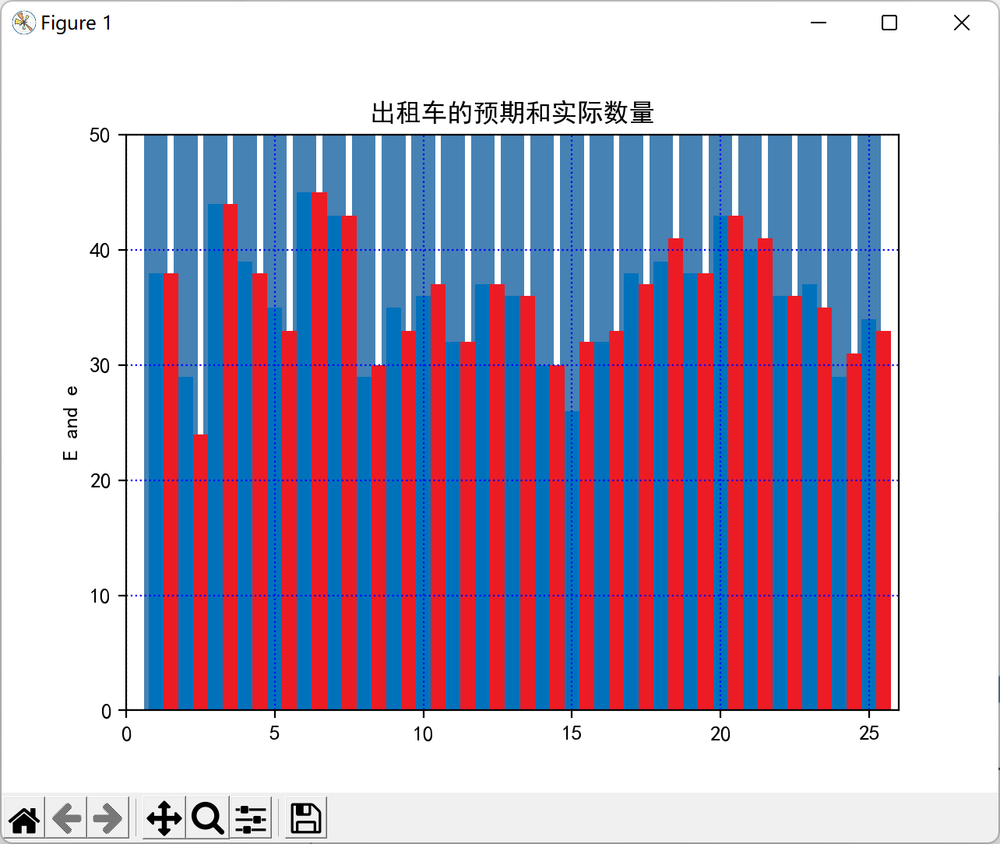
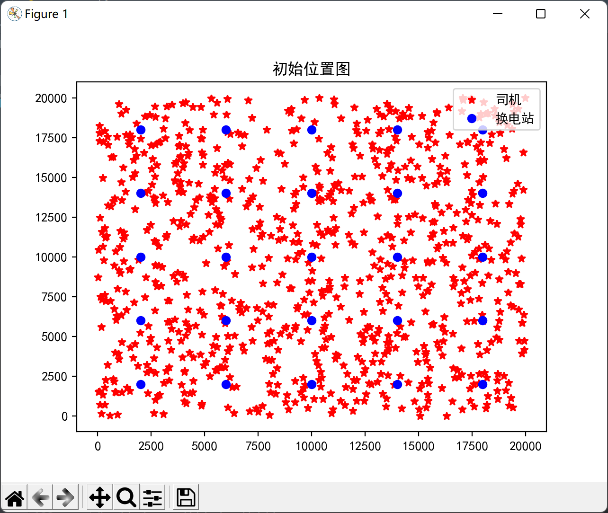
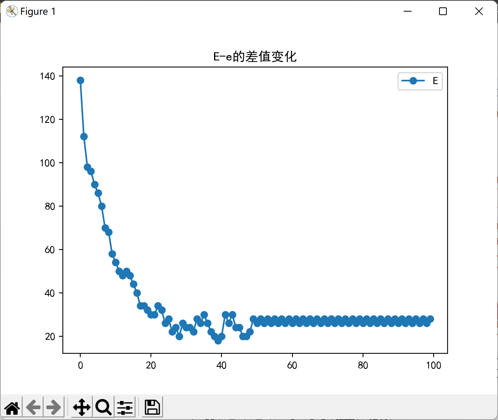
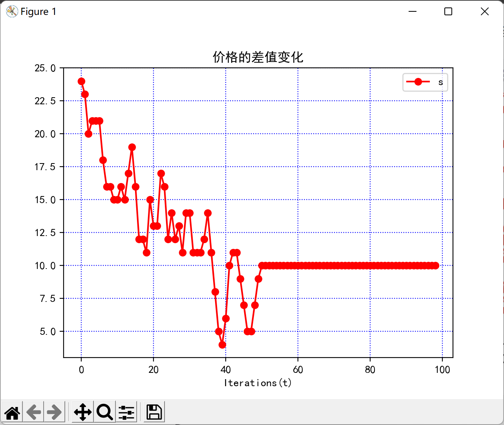

# Game Theory Solution for Electric Vehicles (Python-Matlab Code Implementation)

Game Theory Solution for Electric Vehicles (Python-Matlab Code Implementation)
Here is the Python output:
\n        \n
\n        \n
\n        \n
\n        \n

## Images

<!-- PAYMENT_BLOCK -->

## Get this dataset

- Payment link (Stripe): [Buy now](https://buy.stripe.com/3cs8yP7sY87d0vu9AB)
- Payment QR code: 

<!-- /PAYMENT_BLOCK -->
